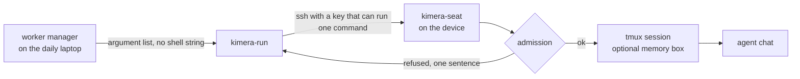

# Kimera

Kimera lets AI coding agents use otherwise idle low-end machines (a 2013 MacBook Air and a 4 GB laptop)
through a narrow, audited door that starts, watches and stops their chats, and it runs small local-model
jobs on the same machines.

It is the devices layer of a personal system called Uruk: Prefrontal keeps the knowledge, AIDEN manages
the workers (agent chats), and Kimera owns the machines and the road to them.

This repository is the public part of a private one. It holds the door, the job switch, their tests and
the measurements. Addresses, host configuration, the desk screens of the machines and the guards stay
private. Version 0.6.1, 13 October 2026.

The history here starts at 0.4.0, one commit per release from then on. The private repository began on 8 October 2026 and held about 60 commits and
13 release tags by this version, all tagged on 13 October; the work itself started in late September.

## The machines

| Name | Machine | What it does |
|---|---|---|
| Tilki | the daily laptop, 8 GB | Where the door is called from. Runs no model. |
| Caretta | MacBook Air 2013, 4 GB, Debian 13 | Takes one agent chat with full tools. Builds and test runs happen here. |
| Kirpi | Lenovo laptop, 4 GB, no graphics card, Debian 13 | Holds a 4B local model for five small jobs, and one read-only agent chat in a 500 MB box. |

The rule behind it: use every machine that can be reached, leave none idle, and never let a guest job take
a machine down.

## How a chat runs on a device



1. The caller runs `kimera-run DEVICE VERB [ARGS]` ([limbs/tilki/run/kimera-run](limbs/tilki/run/kimera-run)).
   There is no free text: a chat name, a session id, a folder and a few values from fixed lists. Each is
   checked against its shape before anything leaves the laptop.
2. The call goes over ssh with a key whose line in the device's `authorized_keys` is
   `restrict,command=".../kimera-seat"`. Whatever is asked, the device runs only that one program
   ([limbs/tilki/run/authorize-device.sh](limbs/tilki/run/authorize-device.sh)).
3. On the device, [limbs/seat/kimera-seat](limbs/seat/kimera-seat) checks the same shapes again, then
   decides admission by its own measurements: free memory, free disk, load against cores, temperature,
   how many chats already run, whether a build is running. A refusal is one sentence and exit code 2.
4. It takes a lock, puts the seat's settings back from a pristine copy, and starts the agent in a tmux
   session. A device can narrow what it accepts: only some permission modes, a forced smaller tool list,
   a memory box (a systemd scope with `MemoryMax` and no swap) so that a chat which grows is the one
   that dies, not its neighbour.
5. Every verb writes one line to the device's own log: time, verb, chat name, outcome. Typed text is
   logged by its length only.

The twelve verbs:

| Verb | What it does |
|---|---|
| `admit` | Would a chat be taken now? `ok` or the reason. |
| `start`, `resume` | Start a chat in a folder under the device's seat roots, or resume one by its id. |
| `seed` | Put a read copy of a git worktree (tracked files at one commit) into the seat folder. |
| `fetch` | What a chat changed in a seeded folder, as one text diff. Links and binary files are refused by name. |
| `has` | Is that chat's session alive? |
| `capture` | The chat's screen as text, cut at 256 KiB. |
| `type` | Text from stdin (64 KiB at most) pasted into the chat. |
| `key` | One of four keys: Enter, Ctrl-U, Escape, Ctrl-C. |
| `kill` | End the session and wait for the process to leave. |
| `facts` | What proves the pane is that chat: process, start time, foreground, machine id, session id. |
| `sample` | One JSON line: free memory, load, swap, temperature, each chat's resident memory. |

Exit codes: 0 yes, 1 no or failed, 2 refused, 3 device away, 4 bad arguments.

Three keys reach a device, each able to do one thing: run the seat program, read the chat transcripts
(read-only `rrsync`), or listen on one loopback port so the device's hooks can reach the worker manager.
None of them gives a shell.

Around the door:

- [kimera-mirror](limbs/tilki/run/kimera-mirror) copies a device's transcripts to the laptop. The device
  is not trusted: files land in a staging folder, are measured (no links, 64 MB a file, 5,000 entries a
  pull, 1 GiB in all), and only then moved in.
- [kimera-perf](limbs/tilki/run/kimera-perf) asks each device for one reading a minute, validates every
  field, keeps the latest in a file other programs may read, and records a line for each minute a chat runs.
- [install-device.sh](limbs/tilki/run/install-device.sh) places everything on a device without root.

The seat currently starts Claude Code's command line. The verbs do not depend on it.

## How a local-model job runs

Kirpi holds one large model at a time: Qwen3.5-4B (Q4_K_S, 2.4 GB, a 4,096-token window) under llama.cpp,
listening on loopback only. [limbs/kirpi/jobs/kimera-job](limbs/kirpi/jobs/kimera-job) is the switch,
called over ssh, answering with one line of JSON:

```sh
kimera-job status                                  # what runs, its state, the lease
kimera-job lease see --minutes 10 --holder NAME    # borrow the machine for a job that changes the model
kimera-job release TOKEN
kimera-job wake                                    # load the text model if it is parked
```

- Text is the resting state. Search by meaning (a small embedding model) and speech-to-text run beside it.
  Only "see a picture" changes the large model, on a lease.
- One lease at a time. A lease that runs out, or whose caller died, returns the machine to text by itself.
- In on-demand mode the text model is dropped after two minutes without work and loaded again by `wake`,
  which frees about 2 GB for a guest chat.
- A timer checks every minute and puts things right: a lease past its time, a model that crashed.

## Measurements

Taken on Kirpi by [limbs/kirpi/jobs/measure.sh](limbs/kirpi/jobs/measure.sh). Its unedited output is
[measured-2026-10-03.txt](limbs/kirpi/jobs/measured-2026-10-03.txt). The script needs that machine with its
models in place, so it is here to be read, not to be run elsewhere.

| What | Result |
|---|---|
| Qwen3.5-4B writing text, three timed answers | 5.8 to 5.9 tokens a second (5.6 while describing a picture) |
| The same model on a real task, five calls, 3,360 tokens in 625 s | 5.4 tokens a second |
| Text model stopped and started again | ready in 6.3 s |
| The model loaded with its vision part | ready in 8.9 s, 728 MB of memory left |
| An 11 s speech clip into text, beside the loaded model (whisper.cpp small, 5-bit) | 8.3 to 8.5 s |
| One picture described | 38.8 s and 50.6 s |
| Lowest free memory during the picture test | 540 MB, 2 GB of swap in use |
| Embedding one 494-token text (Qwen3-Embedding-0.6B, the embedder at that time) | 2.6 s, 191 tokens a second |

The real task is in [experiments/qwen-game](experiments/qwen-game): a small browser game written by the
local model from five instructions. Its [log](experiments/qwen-game/qwen-log.jsonl) has one line per call
with tokens and seconds, and its README says what the model got wrong.

Read live on 13 October 2026 with the `sample` verb, and not recorded in a file here: one agent chat at rest
on Kirpi held 260 to 280 MB of resident memory inside its 500 MB box, while the local model stayed loaded.

## Tests

```sh
python3 limbs/seat/test-seat.py        # 63 checks: the seat, with a temporary home and a fake tmux
python3 limbs/tilki/run/test-perf.py   # 15 checks: readings from a device that lies, is away, or is refused
python3 limbs/kirpi/jobs/test-sim.py   # 18 checks: the job switch against a simulated machine
```

These three need no device and no network, and they pass at this version.

[limbs/kirpi/jobs/test-switch.sh](limbs/kirpi/jobs/test-switch.sh) prints 29 checks against the real machine (numbered 1 to 26, three of them in two or three parts):
unknown jobs refused, a lease granted and refused to a second holder, a forgotten lease ending by itself,
a switch that waits for a running answer, a stopped model coming back. It needs the machine set up and
borrows it for several minutes, so it is not run on every change. Its last full run was on 3 October 2026, before on-demand mode
was added.

## Known limits

- **A chat runs as the device's ordinary user.** So it can edit the files that guard it: the pristine
  settings, the seat program, the memory box it sits in. The guards shorten how long tampering lasts and
  make it visible in the log. They are not a boundary. The fix is a separate unix user for each seat,
  which is not done yet.
- **Built for one person's machines.** There is no multi-user story, no installer for other setups, and
  the device names are written into comments and tests.
- **The job switch's real-machine test predates its newest mode** (see Tests).
- **The door does not check who calls it on the laptop.** Any program of the same user can run
  `kimera-run`. The narrow keys protect the devices, not the laptop.

## What changed, and versions

[CHANGELOG.md](CHANGELOG.md), in SemVer since 0.1.0. Most patch releases are fixes found by security
review of the previous one, and each says what was wrong.

## Authorship

Designed and directed by Burak Tan Bilgi. Built and tested with AI coding agents. Results reviewed by him.

## Licence

[MIT](LICENSE).
